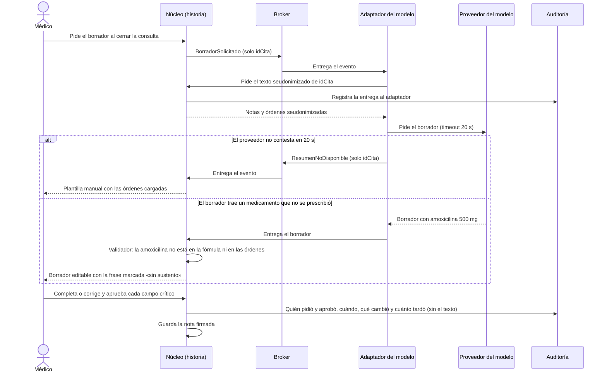

# ADR-002: El modelo de lenguaje propone el borrador de la nota de atención y nada entra a la historia sin la aprobación del médico

Estado: propuesto · Segundo previo, 2026-II · Grupo 4
Autor: Nefer Sneyder Rojas Porras (1152307)
Se deriva del ADR-000 (atributos 1 y 3) y respeta las fronteras del ADR-001. Es el primero de los componentes de IA que
anuncian el caso (§7) y RNF-12.

## Contexto y fuerzas

Al cerrar cada consulta, el profesional escribe la nota de atención (RF-04): motivo, hallazgos, diagnóstico y plan. El
diagnóstico, las órdenes y la fórmula ya se capturan en formularios. Lo que todavía se escribe a mano es el texto libre
que une esas piezas, y ahí es donde un modelo de lenguaje puede ahorrar trabajo.

El punto del sistema es **la nota antes de la firma** (HCL-1). Después de firmada no cambia: cualquier corrección queda
como adenda (RNF-10). Por eso el error que más nos preocupa no es que el modelo falle de forma visible, sino que escriba
algo falso con buena redacción y que eso termine firmado.

| Fuerza | Dato del caso | Qué nos exige |
|---|---|---|
| Gravedad del error | La historia está bajo reserva legal y su integridad es una restricción (caso §1 y §5). Un error firmado solo se corrige con adenda (RNF-10) | Ningún texto del modelo entra sin que el médico lo revise |
| Confidencialidad primero | ADR-000 pone confidencialidad y auditabilidad en el primer lugar, y su atributo 3 dice que por defecto ningún dato clínico sale de la red | El proveedor es una frontera nueva y recibe lo mínimo |
| Fronteras declaradas | ADR-001 y RNF-09: los eventos llevan solo identificadores y cada frontera declara los campos que la cruzan | El texto clínico no viaja en eventos; se entrega por una API que deja traza |
| Datos sensibles | La Ley 1581 de 2012 cuenta los datos relativos a la salud como sensibles (art. 5) y prohíbe tratarlos salvo excepciones, como la autorización explícita del titular (art. 6). Verificado en el texto oficial del Senado, como pide la visión §0 | Solo sale texto seudonimizado, y sin acuerdo de tratamiento con el proveedor no sale nada |
| Sin equipo de seguridad 24/7 | Caso §5 | Si el modelo falla, la atención tiene que seguir sin él y sin daño |
| Volumen | 3.500 citas al día entre 350 profesionales: unas 10 notas por profesional | Lo que se ahorre en una nota se multiplica por 3.500 cada día |
| Espera del médico | El médico atiende una cita tras otra y no puede quedarse esperando al proveedor | Un tiempo límite y un camino sin modelo |
| Costo | Cada llamada se paga según el largo del texto, y podrían ser hasta 3.500 al día | El borrador se genera solo cuando el médico lo pide |
| ¿Cabe en un if? | Lo estructurado ya sale de formularios | El modelo solo escribe el texto libre; el resto sigue siendo determinista |

## Decisión

Combinamos dos de los cinco patrones vistos en clase: **human-in-the-loop**, porque firmar una nota es irreversible, y
**guardrails** a la entrada y a la salida del modelo, porque el médico no debería tener que adivinar qué parte del
borrador es inventada.

1. **El médico pide el borrador** al cerrar la consulta; si no lo pide, no hay llamada al modelo. El núcleo publica
   `BorradorSolicitado` con solo el `idCita`, como los eventos del ADR-001. El modelo solo propone el texto libre: el
   diagnóstico, las órdenes y la fórmula siguen saliendo de los formularios.
2. **El adaptador del modelo** es un trabajador aparte, como los de video y mensajería (visión §6). Consume el evento y
   le pide al núcleo, por API, el texto **seudonimizado** de esa consulta: notas rápidas y órdenes, sin nombre,
   documento ni datos de contacto. El núcleo registra esa entrega en auditoría.
3. El adaptador llama al proveedor con un **tiempo límite de 20 s**.
4. El borrador vuelve al núcleo y pasa por un **validador**. Cada medicamento o dosis del borrador tiene que estar en la
   fórmula o en las órdenes, que es lo que de verdad se prescribió; cada diagnóstico, en el diagnóstico registrado; y
   cada alergia, en las notas del médico. Lo que no cuadre se marca **«sin sustento»**.
5. El médico recibe un **borrador editable** y aprueba por separado cada campo crítico. **Nada se firma sin esa
   aprobación.**
6. Si el proveedor no contesta a tiempo, el médico recibe la **plantilla manual** con las órdenes ya cargadas y sigue
   sin el modelo.
7. **Cada borrador se audita como un hecho:** quién lo pidió, cuándo, si se aprobó tal cual o se editó y cuánto tardó la
   revisión. La auditoría **no guarda el texto**, para no crear otra copia de contenido clínico.

En resumen: el modelo propone, el código marca lo que no tiene respaldo y el médico decide y firma.

Descartamos los otros tres patrones. RAG no aporta, porque el modelo no tiene que buscar en documentos: todo lo que
necesita está en la consulta misma. Tool-calling sobra, porque el modelo no ejecuta nada en el sistema, solo devuelve
texto. Y un orquestador con workers partiría una tarea corta en pasos que acumulan error.

## Alternativas descartadas

| Alternativa | Por qué la descartamos |
|---|---|
| **¿Cabe en un if?** Reglas deterministas, sin modelo | En parte sí, y esa parte ya está resuelta: diagnóstico, órdenes y fórmula salen de formularios y el modelo no los toca. Lo que no cabe en una regla es redactar el texto que une motivo, hallazgos y plan, porque cambia en cada consulta |
| **Sin modelo de lenguaje:** plantilla prellenada con la cita y las órdenes | Es la opción más segura y por eso queda como salida (ver Consecuencias). No la elegimos porque el médico seguiría escribiendo todo el texto libre en cada una de sus ~10 citas diarias. Cada minuto que se ahorre por nota equivale a unos 10 minutos por profesional al día y a unas 58 horas diarias en la red (3.500 notas); cuántos minutos se ahorran de verdad es un supuesto que hay que medir. Además, el caso (§7) anuncia que vienen más componentes de IA, y es mejor fijar ahora el patrón (seudonimizar, validar, aprobar) que improvisarlo después |
| Proveedor externo **sin seudonimizar** | Rompe el atributo 3 del ADR-000, las fronteras del ADR-001 y el art. 6 de la Ley 1581 |
| **Modelo alojado dentro de la red** de 12 IPS | Los datos no saldrían, pero habría que operar infraestructura propia sin equipo 24/7 (caso §5). Tampoco la dejamos como salida: si no hay acuerdo con un proveedor, se vuelve a «sin modelo» |
| **Transcribir el audio** de la videoconsulta | El proveedor de video no recibe datos clínicos (visión §1), solo cubriría las citas virtuales y grabar exige un consentimiento que hoy no se pide |
| **Guardar el resumen sin aprobación** | Un error firmado se queda en una historia bajo reserva legal y solo se corrige con adenda (RNF-10). Es justo el error que esta decisión quiere evitar |

## Modo de falla y control

Hay dos fallas que importan: que el proveedor **no conteste** y que **invente** un dato clínico. El diagrama muestra las
dos, qué las detecta y cómo termina cada una: siempre con el médico decidiendo.

- **Qué falla:** el proveedor no contesta, o devuelve un medicamento, una dosis, una alergia o un diagnóstico que el
  médico nunca registró.
- **Qué lo detecta:** el tiempo límite de 20 s en el adaptador y el validador del núcleo, que compara el borrador con
  la fórmula, las órdenes, el diagnóstico y las notas.
- **Cómo termina:** el médico sigue con la plantilla manual o corrige la frase marcada. En ningún caso se firma algo
  que el médico no aprobó. Si la respuesta del proveedor llega después de los 20 s, el adaptador la descarta, porque el
  médico ya está trabajando con la plantilla.

## Cómo se mide que funciona

- **Conjunto de prueba:** 50 consultas ficticias escritas por el equipo. Cada una trae las notas rápidas, las órdenes,
  un resumen de referencia y sus campos críticos. Son ficticias porque así lo exigen las reglas del repositorio y
  RNF-11.
- **Trampas:** 10 de las 50 traen un medicamento que se menciona y se descarta, una alergia negada o una dosis que
  cambia durante la consulta. Son los casos en que un modelo suele equivocarse con buena redacción.
- **Umbral para aceptar el modelo:**
  - al menos **45 de 50** consultas con todos los campos críticos correctos;
  - **0** medicamentos, dosis o alergias inventados que pasen sin la marca «sin sustento»;
  - **100 %** de las notas firmadas con la aprobación registrada.
- **De dónde sale el 45:** es el acierto que esperamos de dos integrantes que escriban a mano los mismos 50 resúmenes.
  No le pedimos al modelo que sea perfecto, sino que no sea peor que una persona. Es un supuesto que se mide antes de
  adoptar el modelo.
- **Aprobación sin revisar:** salta una alerta si un profesional aprueba 50 borradores seguidos sin editar ninguno
  (unos 5 días de trabajo, a 10 citas diarias) o si los aprueba en menos de 10 s cada uno. Los dos números son supuestos
  que se ajustan con el uso.
- **Cuándo se repite:** cada vez que cambie la instrucción al modelo, el proveedor o el validador.
- Para mostrar la falla basta un adaptador simulado con respuestas predefinidas; no hace falta un modelo real.

## Consecuencias

- **La nota gana un estado:** «borrador pendiente de aprobación», antes de la firma de HCL-1.
- **Una dependencia externa más** en la vista de contenedores: el proveedor del modelo, con su acuerdo de tratamiento
  de datos y un costo por llamada de hasta 3.500 al día. Solo se pagan los borradores que el médico pide.
- **Riesgo de aprobar sin leer.** El human-in-the-loop solo protege si el médico lee, y el validador solo revisa los
  campos críticos: una frase inventada que no sea un medicamento, una dosis, una alergia o un diagnóstico depende de la
  lectura del médico. Por eso la alerta de aprobación sin revisar.
- **Falsos positivos del validador.** Si el borrador nombra un medicamento por su marca y la fórmula por su principio
  activo, la frase sale marcada aunque esté bien, y el médico tiene que quitar la marca. Es tiempo que se resta al
  ahorro.
- **Una pieza más que puede fallar, pero aislada.** El adaptador vive fuera del núcleo; si se cae, la consulta sigue
  con la plantilla manual y el núcleo no suma una dependencia que detenga la atención (EC-02).
- **El punto débil es la seudonimización del texto libre.** Quitar nombre, documento y contacto no basta si las notas
  rápidas mencionan un lugar, un familiar o una fecha que identifican al paciente. Si no podemos defender que el texto
  sale sin identificar, o si no hay acuerdo de tratamiento con el proveedor, la decisión pasa a «sin modelo»
  (plantilla prellenada).

## Qué señal nos haría cambiar de opinión

- Si la medición no llega a 45 de 50, o si una trampa pasa sin marca, el modelo no entra y se queda la plantilla
  prellenada.
- Si los médicos aprueban sin editar de forma sostenida, el control humano es solo de nombre: hay que endurecer la
  aprobación o retirar el modelo.
- Si el costo medido por llamada no compensa el tiempo ahorrado, se vuelve a «sin modelo».
