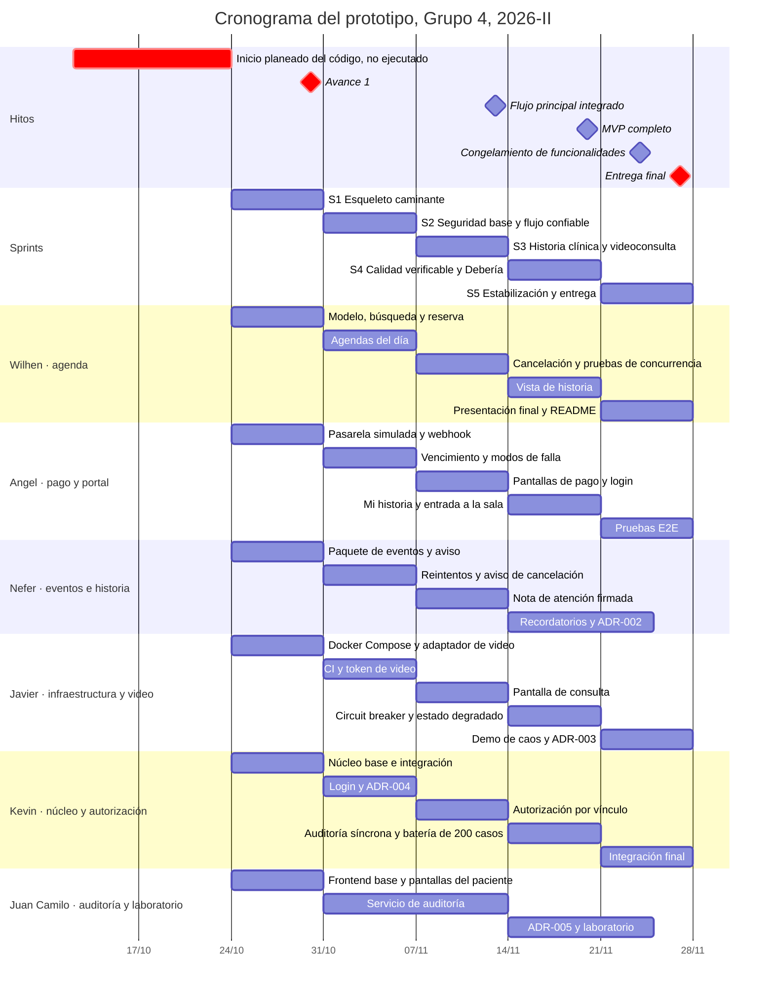

# Plan de trabajo y cronograma del prototipo

Grupo 4 · Caso 4 — Citas médicas y telemedicina · Arquitectura de Software · UFPS 2026-II

Autor: Kevin David Zorro Hernández · 23 de octubre de 2026 · Estado: propuesta para aprobar en la reunión de arranque

## Resumen

El código del prototipo debía empezar el lunes 12 de octubre y, al 23 de octubre, todavía no ha empezado. Del sábado 24
de octubre al viernes 27 de noviembre quedan cinco semanas, que con seis personas a 8 h semanales suman 240 h, o 210 h
netas una vez se descuenta la reunión semanal de cada persona. El retraso ya costó 72 h netas.

Desglosado en 38 requisitos funcionales y 14 no funcionales, el caso completo se estima en 238 h en su valor más
probable y en 258 h según PERT, es decir, entre un 13 % y un 23 % más de lo que el equipo tiene. Por eso el plan
construye primero un **MVP arquitectónico de 163 h** que recorre seis de los siete contenedores de la vista C4 y deja
demostrables los dos escenarios de calidad del grupo: EC-01, en el que nadie sin vínculo asistencial abre una historia
y todo acceso queda en una traza inalterable, y EC-02, en el que agenda e historia siguen respondiendo con el video y la
mensajería caídos. Con los recordatorios y el laboratorio, el plan base sube a 181 h y deja una reserva de 29 h (14 %).

Para el **avance del viernes 30 de octubre**, el equipo mostrará un esqueleto caminante del flujo del ADR-001, en el que
un paciente reserva una cita virtual, paga en una pasarela simulada, el webhook firmado confirma la cita y
`CitaConfirmada` llega en paralelo a los adaptadores de video y de mensajería. Ese sprint cuesta 42 h, 7 por persona,
y su reparto está en la sección 7.

## 1. Supuestos de la estimación

| Supuesto | Valor |
|---|---|
| Inicio planeado del código | Lunes 12 de octubre |
| Fecha de este plan | Viernes 23 de octubre |
| Avance 1 | Viernes 30 de octubre |
| Entrega final | Viernes 27 de noviembre |
| Festivos en el periodo | Lunes 2 y lunes 16 de noviembre |
| Equipo | 6 personas, 8 h por semana cada una |
| Reunión semanal | 1 h por persona, así que quedan 7 h para tareas |
| Horas de cada tarea | Incluyen sus pruebas, el PR y la revisión |
| Sprints | Semanales, de sábado a viernes, para cerrar el mismo día de la semana que el avance y la entrega |
| Stack | El de `docs/contenedores.dsl` (NestJS, PostgreSQL, RabbitMQ y Node.js); frontend y herramientas en la sección 11 |
| Terceros | Pasarela de pagos, video y laboratorio simulados detrás de sus adaptadores; el correo sale a Mailpit |
| Datos | Solo ficticios, en semillas y pruebas |
| Método de estimación | Valor más probable (M) por tarea; PERT con O = 0,7 M y P = 1,8 M, de modo que E ≈ 1,08 M |

Dos supuestos merecen explicación. Los terceros se simulan porque así la demo puede provocar a voluntad un timeout, una
caída o un webhook duplicado, y porque cambiar después a un proveedor real seguirá siendo un cambio local, como pide la
integrabilidad sin fuga del ADR-000; Mailpit es un servidor SMTP de prueba que muestra en el navegador los correos que
recibe. Los factores de PERT son asimétricos porque en software los sobrecostos pesan más que los ahorros.

La guía general del proyecto y su rúbrica no están en el repositorio. [VERIFICAR: qué exige la guía para el avance del
30 de octubre y para la entrega final.] Lo que pida y no esté en este plan se estima y entra según las reglas de la
sección 5.

## 2. Requisitos funcionales

Los ocho requisitos funcionales del caso se desglosan aquí en 38 requisitos verificables. El desglose sale del propio
caso, de los supuestos A-01 y A-02, del ADR-001 y del flujo de agendamiento, y cada fila indica las tareas del plan que
la cubren. La columna Nivel sigue el criterio MoSCoW, en el que Debe entra al MVP, Debería entra si el plan base se
cumple y Podría queda fuera del semestre salvo que sobre tiempo.

| ID | Requisito | Origen | Nivel | Tareas |
|---|---|---|---|---|
| **RF-01** | **Agendamiento presencial y virtual por especialidad, sede y profesional** | | | |
| RF-01.1 | Buscar franjas libres por especialidad, sede, profesional, modalidad y fecha | RF-01 | Debe | AGE-2, AGE-8 |
| RF-01.2 | Reservar la franja de forma exclusiva, sin dobles reservas aunque la solicitud se repita | RF-01, flujo paso 2 | Debe | AGE-3, AGE-7 |
| RF-01.3 | Retener 15 min la franja de la cita virtual en `PENDIENTE_PAGO` mientras el paciente paga | A-02 | Debe | AGE-3 |
| RF-01.4 | Cobrar el copago en línea, con timeout de 5 s al crear la transacción, confirmación por webhook firmado y vencimiento del bloqueo con consulta de respaldo | A-02, ADR-001 | Debe | PAG-1 a PAG-6 |
| RF-01.5 | Cancelar la cita, por el paciente o por la sede, y liberar la franja | RF-01, flujo | Debe | AGE-4 |
| RF-01.6 | Ver la agenda del día del profesional y las citas del día de la sede, sin contenido clínico para el administrativo | Visión §1 | Debe | AGE-5 |
| RF-01.7 | Agendar desde la sede, registrar la autorización de la aseguradora y marcar las no-asistencias | Caso §2, visión §1 | Debería | ADM |
| RF-01.8 | Reasignar o reembolsar un pago aprobado después de vencido el bloqueo | ADR-001 | Podría | — |
| RF-01.9 | Reprogramar citas y gestionar disponibilidad y bloqueos desde la interfaz (en el MVP se cargan por semilla) | Visión §1 | Podría | — |
| **RF-02** | **Recordatorios con confirmación o cancelación** | | | |
| RF-02.1 | Avisar la confirmación y la cancelación con la plantilla mínima (nombre, fecha, hora, sede y enlace al portal) | ADR-001, flujo paso 6 | Debe | MSG-1, MSG-2 |
| RF-02.2 | Programar recordatorios con reintentos, vida útil hasta 3 h antes de la cita y cola de mensajes muertos | RF-02, visión §7 | Debería | REC-1 |
| RF-02.3 | Confirmar o cancelar la cita desde el recordatorio | RF-02 | Debería | REC-2 |
| **RF-03** | **Videoconsulta con la historia visible solo para el tratante** | | | |
| RF-03.1 | Crear la sala sin token al confirmarse la cita y avisar al núcleo con `SalaCreada` | ADR-001, flujo paso 5 | Debe | VID-1, VID-2 |
| RF-03.2 | Emitir el token de vigencia corta cuando el paciente entra | ADR-001 | Debe | VID-3 |
| RF-03.3 | Mostrar al profesional tratante la historia al lado de la llamada, nunca dentro de ella | RF-03, visión §3 | Debe | VID-4 |
| RF-03.4 | Pedir el consentimiento de teleconsulta al entrar | Visión §1 | Debe | VID-5 |
| RF-03.5 | Degradar con baja conectividad, pasando a solo audio, a presencial o a otra fecha | Caso §5, EC-02 | Podría | — |
| **RF-04** | **Registro de la atención con firma** | | | |
| RF-04.1 | Registrar la nota de atención (motivo, hallazgos, diagnóstico y plan) en la historia única del paciente | RF-04 | Debe | HCL-1 |
| RF-04.2 | Firmar la nota, que queda inmutable; las correcciones se agregan como adenda | RF-04, caso §5 | Debe | HCL-1 |
| RF-04.3 | Consultar en línea de tiempo la historia del paciente que se atiende | RF-03, RF-04 | Debe | HCL-2 |
| **RF-05** | **Formulación y órdenes de examen** | | | |
| RF-05.1 | Emitir fórmula y órdenes de examen ligadas a una atención | RF-05 | Debería | FOR |
| RF-05.2 | Enviar la orden digital al laboratorio en convenio | A-01 | Debería | LAB-1 |
| **RF-06** | **Resultados de laboratorio** | | | |
| RF-06.1 | Recibir por cola resultados en formatos heterogéneos (JSON y CSV en el prototipo), al ritmo de cada laboratorio | RF-06, caso §5 | Debería | LAB-1 |
| RF-06.2 | Normalizarlos a un formato común y conciliarlos con la orden y el paciente, con acuse de recibo | RF-06, ADR-005 | Debería | LAB-2 |
| RF-06.3 | Resolver en una bandeja manual lo que no concilia | Visión §7 | Debería | LABUI |
| **RF-07** | **Portal del paciente** | | | |
| RF-07.1 | Ver mis citas con su estado (pago pendiente, confirmada, sala en preparación o cancelada) | RF-07, ADR-001 | Debe | AGE-2, AGE-8, PAG-6, VID-2 |
| RF-07.2 | Ver mi historia y solo la mía | RF-07 | Debe | POR-2 |
| RF-07.3 | Ver mis resultados, fórmulas y órdenes | RF-07 | Debería | FOR, LABUI |
| RF-07.4 | Entrar a la videoconsulta desde el portal | ADR-001 | Debe | VID-5 |
| **RF-08** | **Registro inmutable de todo acceso a una historia** | | | |
| RF-08.1 | Autorizar por vínculo asistencial vigente y denegar por defecto, sin revelar si el paciente existe | RF-08, EC-01, ADR-004 | Debe | AUT-1 |
| RF-08.2 | Registrar cada acceso (quién, cuándo, desde dónde y con qué justificación) antes de entregar la historia, y negarlo si la auditoría no responde | RF-08, visión §7 | Debe | AUD-3, AUT-2 |
| RF-08.3 | Guardar la traza solo por anexado, en un servicio con base y credenciales propias, encadenada con hashes | ADR-000 | Debe | AUD-1, AUD-2 |
| RF-08.4 | Consultar como auditor trazas filtradas, solo metadato y solo lectura | Visión §1 | Debe | AUD-4 |
| RF-08.5 | Registrar por evento, sin duplicados, el metadato del agendamiento | ADR-001 | Debe | AUD-1 |
| RF-08.6 | Permitir el acceso de emergencia con justificación y alertar al responsable de privacidad tras tres intentos denegados en 24 h | EC-01, visión §7 | Debería | EMG |
| **RF-T** | **Transversales** | | | |
| RF-T.1 | Autenticar y asignar los roles de paciente, profesional, administrativo y auditor | Caso §2 | Debe | IDN-1, IDN-2 |
| RF-T.2 | Cargar por semilla las 12 sedes, las especialidades, los profesionales, los pacientes ficticios y las franjas | Caso §1 | Debe | FUN-3 |
| RF-T.3 | Anunciar al operador el estado degradado; bandeja de mensajes muertos con reintento | EC-02, ADR-001 | Debe el aviso; Podría la bandeja | RES-2 |

En total quedan 25 requisitos Debe, 10 Debería y 3 Podría. Siguen fuera del alcance, como ya decidió la visión, la
facturación y los RIPS, la integración con EPS y aseguradoras (la autorización se digita) y las farmacias; tampoco se
harán el envío real de SMS ni una aplicación móvil.

## 3. Requisitos no funcionales

Los requisitos no funcionales salen de las tres demandas de calidad del caso, dos de ellas convertidas por el grupo en
EC-01 y EC-02, y de las decisiones del ADR-000 y el ADR-001. Cada uno conserva la medida que ya fijó el grupo y dice
cómo se comprobará en el prototipo.

| ID | Atributo | Requisito y medida | Origen | Cómo se comprueba | Nivel |
|---|---|---|---|---|---|
| RNF-01 | Confidencialidad | 100 % de los intentos sin vínculo denegados y cero falsos permisos en una batería de 200 casos en cada despliegue; la respuesta no confirma que el paciente exista | EC-01 | Batería en CI (AUT-3) | Debe |
| RNF-02 | Latencia de la autorización | Decisión en 300 ms o menos (p95); si no responde en 2 s, falla cerrada | EC-01, visión §7 | Prueba de timeout (AUT-2); medir el p95 es Podría | Debe |
| RNF-03 | Auditabilidad | 100 % de los accesos registrados en 2 s o menos; ningún rol puede modificar un registro | EC-01, RF-08, ADR-000 | La base rechaza UPDATE y DELETE y un script verifica la cadena de hashes (AUD-1, AUD-2) | Debe |
| RNF-04 | Detección de abuso | Alerta al responsable de privacidad en 5 min o menos tras tres denegaciones en 24 h | EC-01 | EMG | Debería |
| RNF-05 | Disponibilidad selectiva | Agenda e historia al 99,5 % o más entre 6:00 y 20:00, y 0 % de rechazos durante 30 min de caída del video, la mensajería o el laboratorio; la pasarela de pagos queda fuera de esta garantía | EC-02, ADR-000 | Demo de caos (RES-3) | Debe |
| RNF-06 | Aislamiento de fallas | Timeout en toda llamada a terceros; el circuit breaker abre en 5 s o menos tras 5 fallos; la degradación se detecta y anuncia en 30 s o menos | EC-02 | RES-1, RES-2 | Debe |
| RNF-07 | Rendimiento | p95 de 3 s o menos en la hora pico de 500 citas; la creación de la transacción de pago se corta a los 5 s | EC-02, A-02 | Pasarela lenta (PAG-5); la prueba de carga con k6 es Podría | Debe |
| RNF-08 | Entrega confiable | Entrega al menos una vez con consumidores idempotentes, reintentos con espera creciente, cola de mensajes muertos y vida útil; cero avisos perdidos o repetidos | ADR-001, visión §7 | Webhook duplicado y reinicio de un consumidor en la demo (EVT-1, EVT-2) | Debe |
| RNF-09 | Integración sin fuga | Cada frontera declara los campos que la cruzan. A la pasarela van el monto y una referencia opaca; a la mensajería, nombre, fecha, hora y sede; al video, un id opaco y un token corto; en los eventos, solo identificadores | ADR-000, ADR-001, visión §1 | Revisión de contratos y prueba de que el correo no lleva especialidad ni motivo (MSG-1) | Debe |
| RNF-10 | Integridad de la historia | Una nota firmada no cambia y sus correcciones quedan como adenda | Caso §5, RF-04 | HCL-1 | Debe |
| RNF-11 | Cumplimiento normativo | Reserva, retención de largo plazo e integridad de la historia y de los datos personales | Caso §5 | Sin borrado físico de la historia, datos ficticios y política de retención documentada | Debe |
| RNF-12 | Mantenibilidad y evolución | Monolito modular en el que ningún módulo consulta las tablas de otro, con un adaptador por tercero, listo para requisitos nuevos, incluida la IA | Caso §7, visión §6, ADR-000 | Estructura por módulos, revisión en cada PR y ADR-002 | Debe |
| RNF-13 | Operación sin equipo 24/7 | Todo arranca con un comando, las fallas quedan a la vista y los valores por defecto son seguros | Caso §5 | `docker compose up` y RES-2 | Debe |
| RNF-14 | Degradación de la videoconsulta | La videoconsulta degrada con dignidad cuando el ancho de banda es limitado | Caso §5 | El MVP solo muestra «sala en preparación»; el modo solo audio es Podría | Podría |

El ADR-000 también declara lo que no manda (el rendimiento bruto, la riqueza de interfaz y un time-to-market
agresivo), y el plan saca provecho de eso. La interfaz se arma con una biblioteca de componentes, sin diseño propio, y
las horas se concentran en los mecanismos que sostienen EC-01 y EC-02.

## 4. Tamaño de la aplicación

| Medida | Alcance completo | MVP (Debe) |
|---|---|---|
| Requisitos funcionales detallados | 38 | 25 |
| Requisitos no funcionales | 14 | 12 |
| Actores, entre personas y sistemas externos | 8 | 8 |
| Aplicaciones con código propio | 7 | 6 |
| Integraciones con terceros, simuladas | 4 | 3 |
| Eventos | 5 | 3 |
| Pantallas | ≈ 21 | ≈ 12 |
| Endpoints | ≈ 40 | ≈ 25 |
| Tablas | ≈ 20 | ≈ 15 |

Las siete aplicaciones son el núcleo, el servicio de auditoría, los adaptadores de video y de mensajería, el worker de
laboratorio, el frontend y la pasarela simulada; el MVP deja por fuera el worker de laboratorio. La estimación por área,
en horas más probables, queda así:

| Área | Debe | Debería | Podría | Total |
|---|---|---|---|---|
| Fundaciones e integración | 19 | — | — | 19 |
| Eventos y mensajería | 13 | 8 | 4 | 25 |
| Agenda | 21 | 6 | 9 | 36 |
| Pago del copago | 16 | — | 10 | 26 |
| Videoconsulta | 15 | — | 7 | 22 |
| Identidad | 8 | — | — | 8 |
| Historia clínica y portal | 14 | 6 | — | 20 |
| Autorización y auditoría | 26 | 6 | — | 32 |
| Laboratorio | — | 15 | — | 15 |
| Resiliencia | 8 | — | 4 | 12 |
| ADR-002 a ADR-005, README y diagramas | 10 | — | — | 10 |
| Demos y coordinación | 13 | — | — | 13 |
| **Total** | **163** | **41** | **34** | **238** |

Por número de pantallas, el sistema es mediano. Lo que lo vuelve exigente está debajo de ellas, porque el 45 % de las
horas del MVP se va en infraestructura y mecanismos transversales (identidad, autorización por vínculo, auditoría
inmutable, bandeja de salida, consumidores idempotentes, reintentos y circuit breakers). Una estimación hecha solo con
las pantallas daría una cifra engañosamente baja.

## 5. Capacidad frente al alcance

| Concepto | Horas |
|---|---|
| Capacidad bruta, 6 personas × 8 h × 5 semanas | 240 |
| Reuniones semanales, 6 personas × 1 h × 5 semanas | −30 |
| **Capacidad neta del 24 de octubre al 27 de noviembre** | **210** |
| Horas netas perdidas entre el 12 y el 23 de octubre (1,7 semanas) | 72 |
| Capacidad neta que habría habido empezando el 12 de octubre | 282 |

| Alcance | Más probable (M) | Esperado (PERT) | Pesimista (P) | Esperado frente a 210 h |
|---|---|---|---|---|
| Completo, con Debe, Debería y Podría | 238 | 258 | 428 | 123 % |
| Plan base, con lo Debe más recordatorios y laboratorio | 181 | 196 | 326 | 93 % |
| MVP, solo lo Debe | 163 | 177 | 293 | 84 % |

El alcance completo no cabe ni siquiera en su escenario más probable. Si el código hubiera empezado el 12 de octubre,
las 282 h netas habrían alcanzado para el escenario esperado con un margen de 24 h, así que el retraso, que costó 72 h,
es lo que obliga a recortar. El plan base sí cabe y reserva 29 h (14 %). En el escenario esperado, el sobrecosto se
come unas 15 h de esa reserva y quedan unas 14 h, que alcanzan para dos ítems de la cola de holgura o para un
requisito nuevo pequeño. El escenario pesimista (326 h) no cabe, y para eso existe el punto de control del 13 de
noviembre.

El recorte se gobierna con estas cinco reglas:

1. Ningún requisito nuevo desplaza un ítem Debe.
2. Los Debería del plan base (recordatorios y laboratorio) entran en el S4 solo si se cumple el hito del 13 de
   noviembre; si no, el S4 se dedica a cerrar lo Debe.
3. La cola de holgura la toma, en este orden, quien ya tenga fusionado lo suyo del sprint: fórmula y órdenes (FOR,
   6 h), acceso de emergencia con alerta (EMG, 6 h), agendamiento desde la sede (ADM, 6 h) y bandeja de conciliación
   con resultados en el portal (LABUI, 5 h).
4. Los requisitos nuevos que el caso anuncia, incluidos los componentes de IA, se estiman en la reunión semanal y
   entran desplazando la cola desde el final y, si no alcanza, los Debería del plan base.
5. Las funcionalidades se congelan el **martes 24 de noviembre**. Desde ese día solo se corrigen errores, se escriben
   pruebas y documentación y se ensaya.

Lo Podría suma 34 h en ocho ítems, que quedan documentados como trabajo futuro: reasignar o reembolsar el pago tardío
(4 h), una pasarela real en sandbox (6 h), la reprogramación (3 h), la gestión de disponibilidad desde la interfaz
(6 h), un proveedor de video real (4 h), el modo solo audio (3 h), la prueba de carga con k6 (4 h) y la bandeja de
mensajes muertos con reintento (4 h).

## 6. Plan del semestre

El semestre se organiza en cinco sprints semanales, cada uno con un objetivo que se puede mostrar en su revisión del
viernes.

| Sprint | Fechas | Objetivo | Cierra con | Horas |
|---|---|---|---|---|
| S0 | 12 al 23 de octubre | Inicio del código, planeado y no ejecutado | — | 72 perdidas |
| S1 | 24 al 30 de octubre | Esqueleto caminante del flujo del ADR-001 | **Avance 1**, viernes 30 de octubre | 42 |
| S2 | 31 de octubre al 6 de noviembre | Seguridad base y flujo confiable | Revisión interna | 37 |
| S3 | 7 al 13 de noviembre | Historia clínica y videoconsulta | **Hito: flujo principal integrado**, viernes 13 | 40 |
| S4 | 14 al 20 de noviembre | EC-01 y EC-02 verificables, más los Debería | **Hito: MVP completo**, viernes 20 | 37 |
| S5 | 21 al 27 de noviembre | Estabilización y entrega | Congelamiento el martes 24; **entrega final**, viernes 27 | 25 más 17 de reserva |



La imagen del cronograma para las diapositivas está en `docs/img/cronograma.png`. El detalle de los sprints 2 a 5,
con responsable y horas, es el siguiente; el del sprint 1 está en la sección 7.

### S2 · 31 de octubre al 6 de noviembre · Seguridad base y flujo confiable

| ID | Tarea | Responsable | h |
|---|---|---|---|
| IDN-1 | Login con JWT, contraseñas con hash, cuatro roles y guardas por rol | Kevin | 5 |
| DOC-3 | ADR-004 sobre la autorización por vínculo asistencial, escrito antes de implementarla | Kevin | 2 |
| FUN-5 | Integración continua en GitHub Actions con lint, tipos, pruebas y build | Javier | 2 |
| VID-3 | Token de vigencia corta al entrar, con llamada síncrona del núcleo al adaptador y timeout | Javier | 4 |
| EVT-2 | Reintentos con espera creciente, cola de mensajes muertos y vida útil en `packages/eventos` | Nefer | 3 |
| MSG-2 | Aviso de `CitaCancelada`, salvo cuando falla el paso 3, con idempotencia por `idCita` y `tipoMensaje` | Nefer | 3 |
| AGE-5 | Agenda del día del profesional y citas del día de la sede, sin contenido clínico para el administrativo | Wilhen | 5 |
| COORD | Coordinación del sprint y del tablero | Wilhen | 1 |
| PAG-4 | Tarea programada que vence los bloqueos y consulta el estado a la pasarela antes de liberar | Angel | 4 |
| PAG-5 | Modos de falla de la pasarela simulada (lenta, caída y webhook duplicado) | Angel | 2 |
| AUD-1 | Servicio de auditoría con base y credenciales propias, tabla solo de anexado y consumo idempotente de los eventos del agendamiento | Juan Camilo | 4 |
| AUD-3 | Endpoint síncrono para registrar el acceso a una historia | Juan Camilo | 2 |

En la revisión se muestra el login por rol, un bloqueo vencido que libera el cupo y la pasarela lenta que cancela la
cita a los 5 s. También se ve cómo un mensaje que agota sus reintentos termina en la cola de mensajes muertos y cómo
la base de auditoría rechaza un UPDATE.

### S3 · 7 al 13 de noviembre · Historia clínica y videoconsulta

| ID | Tarea | Responsable | h |
|---|---|---|---|
| AUT-1 | Punto de decisión de autorización por vínculo asistencial, que deniega por defecto y no revela si el paciente existe | Kevin | 6 |
| VID-2 | El núcleo consume `SalaCreada` y el portal muestra «sala en preparación» o «sala lista» | Javier | 2 |
| VID-4 | Pantalla de consulta con el video embebido y la historia al lado | Javier | 5 |
| HCL-1 | Nota de atención firmada con hash, inmutable y con correcciones como adenda | Nefer | 7 |
| AGE-4 | Cancelación por el paciente o la sede, con el cupo liberado y `CitaCancelada` | Wilhen | 2 |
| AGE-7 | Pruebas de concurrencia, en las que de dos reservas simultáneas gana una, y de transiciones de estado | Wilhen | 4 |
| COORD | Coordinación y preparación del hito | Wilhen | 1 |
| PAG-6 | Pantallas de pago pendiente con cuenta regresiva, de retorno de la pasarela y de error del paso 3 | Angel | 3 |
| IDN-2 | Pantalla de login, sesión y navegación por rol | Angel | 3 |
| AUD-2 | Traza encadenada con hashes y script que verifica su integridad | Juan Camilo | 3 |
| AUD-4 | Pantalla del auditor con consulta filtrada, solo metadato y solo lectura | Juan Camilo | 4 |

El viernes 13 se cumple el hito del flujo principal si, con login real, un paciente agenda y paga una cita virtual,
recibe el aviso y el profesional abre la consulta con video, registra la nota y la firma, todo bajo autorización por
vínculo. Ese día también es el punto de control del alcance, según la regla 2 de la sección 5.

### S4 · 14 al 20 de noviembre · EC-01 y EC-02 verificables, más los Debería

| ID | Tarea | Responsable | h |
|---|---|---|---|
| AUT-2 | Registro síncrono del acceso antes de entregar la historia; si la auditoría no responde en 2 s, se niega | Kevin | 3 |
| AUT-3 | Batería de 200 casos de autorización en CI, con cero falsos permisos | Kevin | 4 |
| RES-1 | Timeouts y circuit breaker en las llamadas a terceros, que abre tras 5 fallos | Javier | 3 |
| RES-2 | Estado degradado con el health de los adaptadores y aviso en la interfaz | Javier | 3 |
| REC-1 | Debería. Recordatorios programados con reintentos y vida útil hasta 3 h antes de la cita | Nefer | 5 |
| DOC-1 | ADR-002 sobre el monolito modular | Nefer | 2 |
| HCL-2 | Vista de la historia del paciente en línea de tiempo, reutilizada en la pantalla de consulta | Wilhen | 4 |
| COORD | Coordinación y decisión de alcance | Wilhen | 1 |
| POR-2 | «Mi historia» en el portal, solo la propia, con prueba de acceso a un recurso ajeno | Angel | 3 |
| VID-5 | Entrada del paciente desde el portal, con consentimiento de teleconsulta | Angel | 2 |
| DOC-4 | ADR-005 sobre la normalización de resultados de laboratorio, escrito antes de implementarla | Juan Camilo | 2 |
| LAB-1 | Debería. Simulador de laboratorio que recibe órdenes y responde en JSON y CSV, con ingesta por cola y normalizadores por formato | Juan Camilo | 5 |

El viernes 20 se cumple el hito del MVP completo si la batería de 200 casos corre en CI sin falsos permisos y el acceso
a la historia falla cerrado con la auditoría caída. La tercera condición es que el circuit breaker aísle a un tercero
caído mientras la interfaz anuncia el estado degradado.

### S5 · 21 al 27 de noviembre · Estabilización y entrega

| ID | Tarea | Responsable | h |
|---|---|---|---|
| REC-2 | Debería. Confirmar o cancelar la cita desde el enlace del recordatorio | Nefer | 3 |
| LAB-2 | Debería. Conciliación por orden y paciente, acuse, `ResultadoRecibido` o `ResultadoNoConciliado` y resultado visible en la historia | Juan Camilo | 5 |
| RES-3 | Guion de la demo de caos, que apaga video y mensajería y muestra que agenda e historia siguen respondiendo | Javier | 2 |
| DOC-2 | ADR-003 sobre la videoconsulta con un tercero | Javier | 2 |
| DEM-2 | Pruebas E2E del camino feliz con Playwright | Angel | 4 |
| INT-5 | Integración final y corrección de errores | Kevin | 2 |
| DEM-3 | Presentación final con guion, diapositivas y ensayo | Wilhen | 4 |
| DOC-5 | README de ejecución y diagramas actualizados de componentes del núcleo y de despliegue | Wilhen | 2 |
| COORD | Coordinación de la entrega | Wilhen | 1 |

REC-2 y LAB-2 deben quedar fusionados antes del congelamiento del martes 24. El miércoles 25 y el jueves 26 se dedican
a corregir errores con las 17 h de reserva del sprint y al ensayo general.

## 7. Primer avance: sprint 1, del 24 al 30 de octubre

### 7.1 Qué se muestra el 30 de octubre

El objetivo del sprint 1 es un esqueleto caminante, es decir, la versión más delgada del flujo del ADR-001 que atraviesa
casi todos los contenedores. Mostrarlo funcionando prueba que la arquitectura dejó de ser solo un diagrama y monta la
base sobre la que trabajarán los demás sprints. La auditoría entra en el S2, de modo que el 30 de octubre
`CitaConfirmada` llegará a dos consumidores y no a tres.

Guion de la demo, de unos 7 minutos:

1. Contexto (1 min). Retraso, alcance por niveles y cronograma, con las tablas de las secciones 4 a 6.
2. Arranque (30 s). `docker compose up` levanta el núcleo, las dos bases, RabbitMQ, Mailpit, la pasarela simulada, los
   dos adaptadores y el frontend.
3. Reserva (1 min). Un paciente busca una franja virtual, la reserva y ve «pago pendiente» con el bloqueo de 15 min.
4. Pago (1 min). La pasarela simulada aprueba y el webhook firmado confirma la cita.
5. Eventos (1 min). En la consola de RabbitMQ, `CitaConfirmada` llega en paralelo a las colas de video y de mensajería.
6. Frontera sin fuga (30 s). El correo en Mailpit trae nombre, fecha, hora, sede y enlace al portal, sin especialidad
   ni motivo.
7. Idempotencia (1 min). Se reenvía con curl el mismo webhook firmado y no aparece un segundo `CitaConfirmada`.
8. Próximos pasos (1 min). Hitos del 13 y del 20 de noviembre y riesgos principales.

### 7.2 Reparto por persona

Cada persona tiene 7 h de tareas y 1 h para la reunión de arranque. El reparto sigue lo que cada persona ya escribió en
la fase de diseño. Wilhen diseñó el flujo de agendamiento y queda con la agenda; Angel incorporó la pasarela de pagos
(A-02) y queda con el pago, y Nefer, que escribió el ADR-001, queda con los eventos. Javier hizo la vista de
contenedores y el EC-02, por eso toma la infraestructura y el video, mientras Kevin, que escribió el EC-01, toma el
núcleo, porque ahí se decide dónde vivirán la autorización y la auditoría. Juan Camilo arma el frontend en este sprint
y desde el S2 pasa a la auditoría y el laboratorio, cuyo régimen síncrono o por cola analizó en la visión.

| Persona | Tareas | h | PR fusionado a más tardar |
|---|---|---|---|
| **Wilhen Gutiérrez** (líder), agenda | **AGE-1** Modelo de franja y cita con sus estados (2 h)<br>**AGE-2** API de búsqueda de franjas libres y de «mis citas» (2 h)<br>**AGE-3** Reserva exclusiva con `Idempotency-Key`, restricción única y bloqueo de 15 min, con prueba de doble reserva (3 h) | 7 | AGE-1 y AGE-2, martes 27; AGE-3, miércoles 28 |
| **Javier Rincón**, infraestructura y video | **FUN-1** Monorepo con npm workspaces, TypeScript estricto, ESLint y Prettier (2 h)<br>**FUN-2** `docker-compose.yml` con el PostgreSQL del núcleo, el PostgreSQL de auditoría, RabbitMQ y Mailpit, más `.env.example` (3 h)<br>**VID-1** Adaptador de video mínimo que consume `CitaConfirmada`, crea una sala simulada con id opaco y publica `SalaCreada` (2 h) | 7 | FUN-1 y FUN-2, domingo 25; VID-1, miércoles 28 |
| **Angel Montañez**, pago del copago | **PAG-1** Pasarela simulada con creación de transacción, página para aprobar o rechazar y webhook firmado con HMAC (2 h)<br>**PAG-2** Inicio del pago desde el núcleo con timeout de 5 s, idempotente por `idCita` y con compensación (2 h)<br>**PAG-3** Webhook con verificación de firma, idempotencia por `idTransaccion`, cambio de estado y evento en la bandeja de salida, con pruebas de firma inválida y de duplicado (3 h) | 7 | PAG-1, lunes 26; PAG-2 y PAG-3, miércoles 28 |
| **Nefer Rojas**, eventos y mensajería | **EVT-1** Paquete `eventos` con contratos en zod, publicador con bandeja de salida y consumidor idempotente, con prueba de mensaje repetido (4 h)<br>**EVT-3** Bandeja de salida en el núcleo, con su tabla y el proceso que publica (1 h)<br>**MSG-1** Adaptador de mensajería mínimo que pide al núcleo los datos del aviso y envía el correo a Mailpit con la plantilla mínima (2 h) | 7 | EVT-1, martes 27; EVT-3 y MSG-1, miércoles 28 |
| **Kevin Zorro**, núcleo e integración | **FUN-3** Esqueleto del núcleo NestJS con los módulos agenda, pagos, historia, autorización e identidad, configuración por entorno, health, Prisma, migración inicial y semilla de catálogos (5 h)<br>**INT-1** Revisión de PR, integración del flujo completo, ensayo y operación de la demo (2 h) | 7 | FUN-3, lunes 26; integración, jueves 29 |
| **Juan Camilo Uribe**, frontend y presentación | **FUN-4** Esqueleto del frontend con Vite, React y TypeScript, rutas, cliente de API y selector de usuario semilla solo para desarrollo (3 h)<br>**AGE-8** Pantallas del paciente para buscar, reservar, ir a la pasarela y ver sus citas (3 h)<br>**DEM-1** Diapositivas y guion de la demo (1 h) | 7 | FUN-4, lunes 26; AGE-8, miércoles 28; DEM-1, jueves 29 |
| **Total** | | **42** | |

### 7.3 Calendario de la semana

| Día | Qué pasa |
|---|---|
| Sábado 24 | Reunión de arranque de 1 h para aprobar este plan, los contratos de la sección 7.5 y las decisiones de la sección 11, y para crear el tablero con un issue por tarea. Javier empieza FUN-1 y FUN-2, Angel empieza PAG-1 y Juan Camilo empieza FUN-4, porque no dependen de nadie |
| Domingo 25 | Javier fusiona la estructura y el `docker-compose.yml`. Nefer empieza EVT-1 |
| Lunes 26 | Kevin fusiona el esqueleto del núcleo con la semilla, el punto crítico de la semana. Angel fusiona PAG-1 y Juan Camilo, FUN-4 |
| Martes 27 | Wilhen fusiona AGE-1 y AGE-2, y Nefer, EVT-1 |
| Miércoles 28 | Wilhen fusiona AGE-3; Angel, PAG-2 y PAG-3; Nefer, EVT-3 y MSG-1; Javier, VID-1. Juan Camilo conecta AGE-8 con la API real |
| Jueves 29 | Todo queda fusionado antes de las 12:00. Kevin integra y corre el flujo completo, y en la noche se hace un ensayo de 30 min en el que Wilhen presenta y Kevin opera la demo. Juan Camilo cierra las diapositivas |
| Viernes 30 | **Avance 1** |

### 7.4 Ruta crítica y plan B

La ruta crítica pasa por la estructura y el `docker-compose.yml` (domingo 25), el esqueleto del núcleo (lunes 26), la
reserva y la bandeja de salida (martes 27 y miércoles 28), el pago (miércoles 28) y la integración (jueves 29).
Mientras llega cada pieza, el resto del equipo trabaja contra los contratos de la sección 7.5 con datos simulados, así
que un día de retraso en el núcleo no detiene a nadie, aunque sí recorta el tiempo de integración. Si el jueves a las
12:00 el flujo no corre de punta a punta, la demo se hace por tramos, con la reserva y el pago desde Swagger y los
eventos alimentados por un publicador de prueba, y el retraso se presenta junto con este plan.

### 7.5 Contratos y estructura para trabajar en paralelo

Esta propuesta permite que nadie tenga que esperar a otra persona desde el sábado; la reunión de arranque la aprueba o
la ajusta.

```text
Estructura del repositorio
  apps/nucleo                  NestJS: agenda, pagos, historia, autorizacion, identidad
  apps/auditoria               servicio de auditoría con su propia base (S2)
  apps/adaptador-video         worker
  apps/adaptador-mensajeria    worker
  apps/worker-laboratorio      worker (S4)
  apps/pasarela-simulada       solo desarrollo y demo
  apps/web                     React + Vite
  packages/eventos             contratos, publicador y consumidor idempotente
  docker-compose.yml

Núcleo, REST bajo /api/v1
  GET  /franjas?especialidadId&sedeId&profesionalId&modalidad=VIRTUAL|PRESENCIAL&fecha=AAAA-MM-DD
  POST /citas            cabecera Idempotency-Key; cuerpo { franjaId, modalidad }
       201 virtual       { id, estado: "PENDIENTE_PAGO", bloqueoVenceEn, urlPago }
       201 presencial    { id, estado: "CONFIRMADA" }
       409 la franja ya está tomada · 503 la pasarela no respondió y la cita queda CANCELADA
  GET  /citas/mias
  POST /pagos/webhook    cabecera X-Firma (HMAC-SHA256 del cuerpo)
                         cuerpo { idTransaccion, referencia, estado: "APROBADO" | "RECHAZADO" }

Núcleo, uso interno de los adaptadores
  GET  /internal/v1/citas/{idCita}/aviso  ->  { nombre, correo, fecha, hora, sede, enlacePortal }

Pasarela simulada
  POST /transacciones                  { referencia, monto } -> { idTransaccion, urlPago }
  GET  /pagar/{idTransaccion}          página con Aprobar y Rechazar
  GET  /transacciones/{idTransaccion}  -> { estado }   consulta de respaldo (S2)

Eventos, exchange "citas" de tipo topic; todos llevan idEvento (UUID) y ocurridoEn (ISO 8601, UTC)
  cita.confirmada   CitaConfirmada { idCita, idPaciente, modalidad }
  cita.cancelada    CitaCancelada  { idCita, idPaciente, motivo }
                    motivo: FALLA_INICIO_PAGO | PAGO_RECHAZADO | BLOQUEO_VENCIDO | CANCELADA_POR_PACIENTE | CANCELADA_POR_SEDE
  sala.creada       SalaCreada     { idCita, idSala }

Colas, una por consumidor y cada una con su cola de mensajes muertos
  video.cita-confirmada · mensajeria.cita-confirmada · mensajeria.cita-cancelada (S2)
  auditoria.citas (S2) · nucleo.sala-creada (S3)
```

Los nombres siguen el lenguaje del dominio de los ADR (`CitaConfirmada`, `idCita`, `PENDIENTE_PAGO`). Los eventos
llevan solo identificadores, como manda el ADR-001; `modalidad` se agrega para que el adaptador de video ignore las
citas presenciales, y por la misma regla el adaptador de mensajería pide al núcleo los campos del aviso en lugar de
recibirlos en el evento. Cada consumidor guarda su tabla de mensajes procesados `(idMensaje, consumidor, fecha)`, con
restricción de unicidad, en un esquema propio dentro del PostgreSQL del núcleo; la auditoría usa su propia instancia.

### 7.6 Definición de terminado del sprint 1

- Cada tarea entra a `main` por un PR revisado por otra persona.
- Todo arranca con `docker compose up` siguiendo el README.
- Las tres reglas que promete la demo tienen prueba automática: la doble reserva rechazada (AGE-3), el webhook con firma
  inválida o duplicado (PAG-3) y el consumidor que ignora un mensaje repetido (EVT-1).
- El ensayo del jueves recorre el guion completo en menos de 8 minutos.

## 8. Reparto del semestre por persona

| Persona | Responsable de | Pareja de revisión | Horas del plan base | Holgura |
|---|---|---|---|---|
| Wilhen Gutiérrez (líder) | Agenda y estados de la cita, coordinación y presentación final | Angel | 32 | 3 |
| Angel Montañez | Pasarela simulada, pago del copago, login, portal del paciente y pruebas E2E | Wilhen | 28 | 7 |
| Nefer Rojas | Paquete de eventos, mensajería, recordatorios y nota de atención firmada; ADR-002 | Javier | 30 | 5 |
| Javier Rincón | Infraestructura, CI, adaptador de video, pantalla de consulta y resiliencia (EC-02); ADR-003 | Nefer | 30 | 5 |
| Kevin Zorro | Núcleo, integración, identidad y autorización por vínculo (EC-01); ADR-004 | Juan Camilo | 29 | 6 |
| Juan Camilo Uribe | Frontend base, servicio de auditoría y laboratorio; ADR-005 | Kevin | 32 | 3 |

| Horas de tareas por sprint | S1 | S2 | S3 | S4 | S5 | Total |
|---|---|---|---|---|---|---|
| Wilhen | 7 | 6 | 7 | 5 | 7 | 32 |
| Javier | 7 | 6 | 7 | 6 | 4 | 30 |
| Angel | 7 | 6 | 6 | 5 | 4 | 28 |
| Nefer | 7 | 6 | 7 | 7 | 3 | 30 |
| Kevin | 7 | 7 | 6 | 7 | 2 | 29 |
| Juan Camilo | 7 | 6 | 7 | 7 | 5 | 32 |
| **Total** | **42** | **37** | **40** | **37** | **25** | **181** |

Nadie pasa de 7 h de tareas en ningún sprint, el tope que deja la hora de reunión. Las parejas de revisión coinciden con
las fronteras del flujo. Agenda y pago cubren los pasos 1 a 4; eventos, video y mensajería, los pasos 5 y 6, mientras
autorización y auditoría sostienen el EC-01. Cada persona revisa los PR de su pareja y la reemplaza si se atrasa. La
holgura queda sobre todo en Angel, Kevin, Nefer y Javier, que tienen prioridad para tomar la cola de holgura o apoyar a
quien se atrase; Wilhen tiene menos porque ya carga 4 h de coordinación.

## 9. Riesgos

| Riesgo | Probabilidad | Impacto | Mitigación | Responsable |
|---|---|---|---|---|
| La estructura, el `docker-compose.yml` o el núcleo llegan tarde y frenan el S1 | Media | Alto | Contratos aprobados el sábado, trabajo contra simulaciones y plan B de la demo | Javier y Kevin |
| Curva de aprendizaje de NestJS, Prisma o RabbitMQ | Alta | Medio | Un único paquete de eventos para todo el equipo, ejemplos en el README y trabajo en pareja con la persona responsable del módulo | Nefer y Kevin |
| La integración se deja para el final de cada sprint | Media | Alto | PR pequeños, fusión diaria, CI desde el S2 e integración cada jueves | Kevin |
| Llega un requisito nuevo, incluida la IA | Alta | Medio | Reglas de la sección 5 y reserva de 29 h | Wilhen |
| Semanas cargadas por otras materias o por los festivos del 2 y el 16 de noviembre | Alta | Medio | Pareja suplente por módulo y aviso el mismo día del atraso | Wilhen |
| El sobrecosto se acerca al escenario pesimista de 326 h | Media | Alto | Punto de control del 13 de noviembre; los Debería salen antes que cualquier Debe | Wilhen |
| Un proveedor real de pago o de video exige cuentas o cambia sus condiciones | Baja | Bajo | Simuladores detrás de adaptadores; el proveedor real es Podría | Angel y Javier |
| La guía del proyecto pide entregables que este plan no contempla | Media | Medio | Revisar la guía y la rúbrica en la reunión de arranque y ajustar el plan | Wilhen |

## 10. Forma de trabajo

- El tablero vive en GitHub Projects, con un issue por tarea y el ID en el título, por ejemplo «AGE-3 Reserva exclusiva».
- Cada tarea se trabaja en una rama `feat/<id>-<tema>` creada desde `main`, por ejemplo `feat/age-3-reserva`, y entra
  por un PR pequeño con la plantilla del repositorio, revisado por la pareja y fusionado con squash.
- La reunión semanal de 1 h cierra cada sprint con la revisión de lo hecho y la planeación del siguiente. A mitad de
  semana, cada persona reporta por escrito en el grupo lo que hizo, lo que sigue y lo que le impide avanzar.
- Una tarea está terminada cuando su PR está revisado y fusionado, sus pruebas pasan (en CI desde el S2), corre con
  `docker compose up`, la documentación o el ADR quedaron al día si aplicaba y no lleva secretos ni datos reales.
- Quien vaya a incumplir una fecha lo avisa el mismo día, y su pareja decide con Wilhen si toma la tarea o si se
  recorta.
- Cada ADR lo escribe quien implementa la decisión, antes de implementarla cuando sea posible.
- Wilhen actualiza este documento en la reunión semanal cuando cambien el alcance o las fechas.

## 11. Decisiones técnicas para la reunión de arranque

| Decisión | Propuesta | Por qué | Alternativa |
|---|---|---|---|
| Frontend | React con Vite y TypeScript, más una biblioteca de componentes como MUI o Mantine | La aplicación vive detrás de un login, así que una SPA basta, y la biblioteca evita diseñar componentes en un sistema en el que la riqueza de interfaz no manda | Next.js, que solo se justificaría si hiciera falta renderizar en servidor |
| Acceso a datos | Prisma con migraciones versionadas, más SQL propio para la restricción única de la franja y los triggers de la auditoría | Da cliente tipado y migraciones simples a un equipo que empieza | TypeORM, si el equipo ya lo domina |
| Monorepo | npm workspaces | No agrega herramientas y alcanza para siete aplicaciones y un paquete | pnpm con Turborepo |
| Cliente de RabbitMQ | amqplib envuelto en `packages/eventos` | Da control directo sobre acuses, reintentos y colas de mensajes muertos, que son el centro del ADR-001 | @golevelup/nestjs-rabbitmq |
| Autenticación | JWT propio con roles | Basta para cuatro roles y no suma otro servidor que operar | Keycloak, que pesa demasiado para cinco semanas |
| Terceros | Simuladores propios de pasarela, video y laboratorio, y correo a Mailpit | Permiten provocar fallas en la demo sin depender de cuentas externas | Sandbox de una pasarela real, como ítem Podría |
| Idempotencia de los adaptadores | Tabla de mensajes procesados en un esquema propio de cada adaptador dentro del PostgreSQL del núcleo | Cumple el ADR-001 sin otra base que operar y sin que un módulo lea las tablas de otro | Una base por adaptador |
